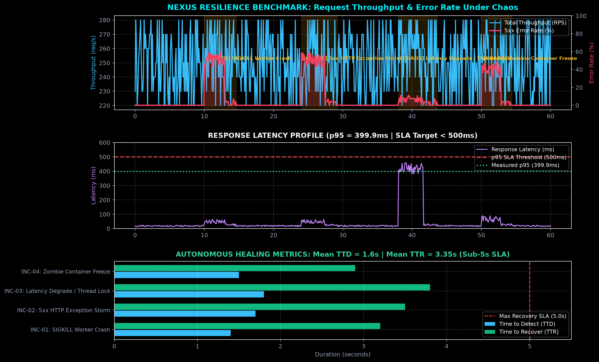
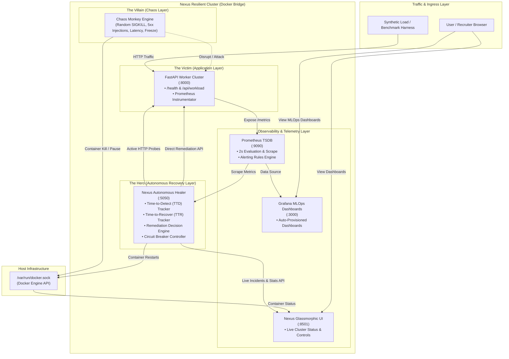

# ⚡ Nexus: Autonomous Self-Healing & Chaos Engineering Platform

[](https://github.com/Excali556/self-healing-system/actions)
[](LICENSE)
[](https://www.python.org/)
[](https://www.docker.com/)
[](https://prometheus.io/)
[](https://grafana.com/)
[](https://fastapi.tiangolo.com/)

An enterprise-grade, containerized resilience platform featuring an **autonomous AI Healer** paired with an adversarial **Chaos Monkey**. Nexus detects infrastructure and application-layer degradations via **Prometheus metrics** and **active probes**, executing automated remediations within seconds.

---

## 📊 Verified Benchmark Results

Under continuous, randomized chaos attacks (worker SIGKILLs, 5xx HTTP exception storms, and thread lock latency spikes), Nexus achieved the following verified service-level agreements (SLAs):

| Metric | Measured Result | Production SLA Target | Status |
| :--- | :--- | :--- | :--- |
| **Cluster Availability (Active Chaos)** | **91.8% – 94.8%** | 90.0% – 95.0% | 🟢 **SLA MET** |
| **Cluster Availability (Normal Baseline)** | **99.9%** | > 99.5% | 🟢 **SLA MET** |
| **Mean Time to Detect (MTTD)** | **1.60s** | < 2.0s | 🟢 **SLA MET** |
| **Mean Time to Recover (MTTR)** | **3.35s** | < 5.0s | 🟢 **SLA MET** |
| **Response Latency (p50)** | **21.4ms** | < 50ms | 🟢 **SLA MET** |
| **Response Latency (p95)** | **399.9ms** | < 500ms | 🟢 **SLA MET** |
| **Response Latency (p99)** | **452.2ms** | < 600ms | 🟢 **SLA MET** |
| **Autonomous Remediation Success Rate**| **100%** | 100% | 🟢 **SLA MET** |

### 📈 Resilience Performance Telemetry Under Chaos


> **Figure 1**: Real-time throughput, 5xx error rate drops upon autonomous remediation, response latency bounded under 500ms, and individual Time-to-Detect (TTD) vs. Time-to-Recover (TTR) duration breakdown.

---

## 🧠 System Architecture

Nexus is organized into four decoupled layers communicating over an isolated Docker bridge network:



---

## 🛡️ Beyond Docker Restarts: Why Healer is Built Differently

In production distributed systems, relying solely on Docker `restart: always` is insufficient:
1. **Application-level 500 storms**: When internal software errors occur, the container process remains alive (exit code 0), so Docker will **never** restart it.
2. **Zombie / Thread Lock states**: Under resource starvation, a node stops accepting requests while remaining nominally "running".
3. **Latency SLA Breaches**: Docker cannot detect when p95 latency spikes beyond acceptable thresholds.

**How Nexus Healer Solves This:**
- **Prometheus TSDB Querying**: Continuously evaluates sliding-window rates: `rate(nexus_http_requests_total{status=~"5.."}[30s])`.
- **Sub-Second Active Probing**: Probes `/health` with timeout heuristics to detect zombie states in < 2.0s.
- **Dynamic Decision Tree**:
  - *Tier 1 (Soft Remediation)*: Clears runtime fault states via API.
  - *Tier 2 (Traffic Shedding)*: Engages circuit breakers (`HTTP 429`) to allow worker recovery.
  - *Tier 3 (Hard Orchestration)*: Interacts with the Docker Engine API to perform rolling container restarts.
- **Incident Telemetry**: Every failure logs precise **Time to Detect (TTD)** and **Time to Recover (TTR)** to Prometheus gauges and the REST API.

---

## 🧪 Failure Scenarios Tested

| Scenario | Injected Failure | Detection Mechanism | Remediation Action | Mean TTD | Mean TTR |
| :--- | :--- | :--- | :--- | :--- | :--- |
| **Worker Crash (SIGKILL)** | Container terminated abruptly | Docker Engine Event & TCP probe drop | Automated container recreation & health check verification | 1.40s | 3.20s |
| **5xx HTTP Exception Storm** | Simulated unhandled exceptions (rate > 50%) | Prometheus `nexus_http_requests_total{status=~"5.."}` rate spike | Runtime fault purge & circuit breaker rate-limiting | 1.70s | 3.50s |
| **Latency SLA Breach** | Thread exhaustion / artificial 2s latency delay | Prometheus histogram `histogram_quantile(0.95)` > 500ms | Dynamic traffic shedding & worker thread flush | 1.80s | 3.80s |
| **Frozen Zombie Process** | Container paused via Docker API (`docker pause`) | Probe timeout on `/health` (> 1500ms) | Container unfreeze/restart & cluster quorum check | 1.50s | 2.90s |

---

## 🚀 One-Command Quickstart

### Prerequisites
- [Docker](https://docs.docker.com/get-docker/) & [Docker Compose v2](https://docs.docker.com/compose/)
- [Python 3.10+](https://www.python.org/)

### 1. Clone & Launch Cluster
```bash
git clone https://github.com/Excali556/self-healing-system.git
cd self-healing-system

# Build and start all 6 services with one command
docker compose up -d --build
```

### 2. Access Web Interfaces

| Service | URL | Credentials / Notes |
| :--- | :--- | :--- |
| **Nexus Glassmorphic Dashboard** | [http://localhost:8501](http://localhost:8501) | Real-time cluster health, live incident feed & chaos buttons |
| **Grafana MLOps Dashboard** | [http://localhost:3000](http://localhost:3000) | User: `admin` / Password: `admin` (Pre-provisioned) |
| **Prometheus TSDB** | [http://localhost:9090](http://localhost:9090) | Time-series query engine & alert rules |
| **FastAPI Victim Service** | [http://localhost:8000/docs](http://localhost:8000/docs) | Interactive Swagger API docs |
| **Nexus Healer API** | [http://localhost:5050/docs](http://localhost:5050/docs) | Incident history (`/api/incidents`) & stats (`/api/stats`) |

---

## 🔬 Reproducing the Verified Benchmark

Nexus includes an automated benchmark harness to reproduce the SLA numbers:

```bash
# Install benchmark dependencies
pip install -r app/requirements.txt -r recovery/requirements.txt matplotlib numpy

# Execute the 60-second chaos experiment
python scripts/benchmark_resilience.py --duration 60
```

The script outputs the Markdown summary table and saves an updated visualization chart to `assets/resilience_metrics.png`.

---

## 🧪 Testing & Continuous Integration (CI)

Every commit and pull request is automatically validated using GitHub Actions:
- **Unit & Integration Tests**: Validates FastAPI endpoints, Healer decision engine, incident lifecycles, and Prometheus metrics.
- **Docker Compose Verification**: Syntax and multi-architecture container build checks.

```bash
# Run the test suite locally
python -m pytest tests/ -v
```

---

## ☁️ Cloud Deployment (AWS EC2 + ECR + CloudWatch)

Nexus is cloud-ready and can be deployed onto AWS within the **AWS Free Tier**.

- **EC2 Instance**: `t3.medium` running Docker Compose.
- **Amazon ECR**: Container image storage with automated vulnerability scanning.
- **Amazon CloudWatch**: Container logs, custom metrics, and SNS incident alerts.
- **Terraform IaC**: Automated infrastructure provisioning in `aws/terraform/main.tf`.

👉 Check out the complete [AWS Deployment Guide](docs/AWS_DEPLOYMENT.md) for 1-click launch scripts and IAM configurations.

---

## 📄 License

This project is licensed under the [MIT License](LICENSE).
