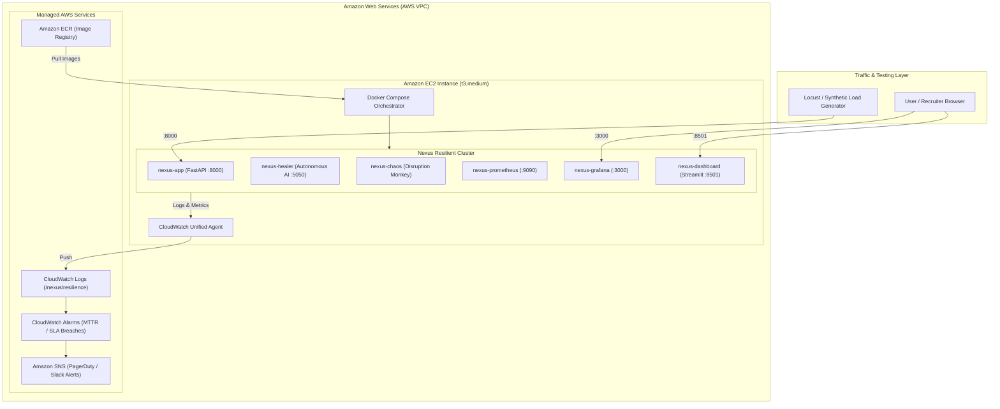

# ☁️ Nexus Cloud Deployment Guide (AWS EC2 + ECR + CloudWatch)

This guide walks through deploying the **Nexus Self-Healing Architecture** on AWS infrastructure using **Amazon EC2**, **Amazon ECR**, and **Amazon CloudWatch**.

---

## 🏗️ AWS Cloud Architecture



---

## 🚀 1-Click EC2 Deployment

### 1. Launch EC2 Instance
- **AMI**: Ubuntu 22.04 LTS (HVM) or Amazon Linux 2023
- **Instance Type**: `t3.medium` (2 vCPU, 4GB RAM)
- **Storage**: 20 GiB gp3
- **Security Group Inbound Rules**:
  - `SSH` (Port 22) from your IP
  - `TCP 8501` (Streamlit Dashboard)
  - `TCP 3000` (Grafana Observability)
  - `TCP 9090` (Prometheus)
  - `TCP 8000` (FastAPI Victim App)
  - `TCP 5050` (Autonomous Healer API)

### 2. Connect and Run Deployment Script
```bash
ssh -i "your-key.pem" ubuntu@<ec2-public-ip>

# Download and execute the automated deploy script
curl -fsSL https://raw.githubusercontent.com/Excali556/self-healing-system/main/aws/deploy_ec2.sh | bash
```

The script will automatically:
1. Install Docker Engine and Docker Compose Plugin.
2. Clone the repository and configure network isolation.
3. Build all microservice containers.
4. Launch Prometheus, Grafana, FastAPI, Healer, Chaos Monkey, and Streamlit.

---

## 📦 Pushing Container Images to Amazon ECR

To use pre-built images from Amazon Elastic Container Registry (ECR):

```bash
# 1. Authenticate Docker with AWS ECR
aws ecr get-login-password --region us-east-1 | docker login --username AWS --password-stdin <ACCOUNT_ID>.dkr.ecr.us-east-1.amazonaws.com

# 2. Tag local images
docker tag nexus-app:latest <ACCOUNT_ID>.dkr.ecr.us-east-1.amazonaws.com/nexus-app:latest
docker tag nexus-healer:latest <ACCOUNT_ID>.dkr.ecr.us-east-1.amazonaws.com/nexus-healer:latest
docker tag nexus-chaos:latest <ACCOUNT_ID>.dkr.ecr.us-east-1.amazonaws.com/nexus-chaos:latest
docker tag nexus-dashboard:latest <ACCOUNT_ID>.dkr.ecr.us-east-1.amazonaws.com/nexus-dashboard:latest

# 3. Push to ECR
docker push <ACCOUNT_ID>.dkr.ecr.us-east-1.amazonaws.com/nexus-app:latest
docker push <ACCOUNT_ID>.dkr.ecr.us-east-1.amazonaws.com/nexus-healer:latest
docker push <ACCOUNT_ID>.dkr.ecr.us-east-1.amazonaws.com/nexus-chaos:latest
docker push <ACCOUNT_ID>.dkr.ecr.us-east-1.amazonaws.com/nexus-dashboard:latest
```

---

## 📈 CloudWatch Logging & Alarms Setup

Install and attach the CloudWatch Agent config located at `aws/cloudwatch-agent-config.json`:

```bash
# Install CloudWatch Agent on EC2
sudo wget https://s3.amazonaws.com/amazoncloudwatch-agent/ubuntu/amd64/latest/amazon-cloudwatch-agent.deb
sudo dpkg -i -E ./amazon-cloudwatch-agent.deb

# Start CloudWatch Agent with Nexus configuration
sudo /opt/aws/amazon-cloudwatch-agent/bin/amazon-cloudwatch-agent-ctl \
  -a fetch-config \
  -m ec2 \
  -s \
  -c file:/opt/nexus/aws/cloudwatch-agent-config.json
```

---

## 💰 Free Tier & Cost Optimization

| Service | Configuration | Monthly Estimated Cost |
| :--- | :--- | :--- |
| **Amazon EC2** | 1x `t3.micro` or `t3.medium` (spot or on-demand for demo) | $0.00 (within Free Tier) / ~$0.04/hr |
| **Amazon ECR** | 4 private repositories (< 1 GB) | $0.00 (Free Tier 500MB/mo) |
| **Amazon CloudWatch**| 10 custom metrics, 5GB logs | $0.00 (within Free Tier) |
| **Data Transfer** | Outbound to internet (< 10 GB) | $0.00 (Free Tier) |
| **Total** | | **$0.00 - $3.00 / month** |
